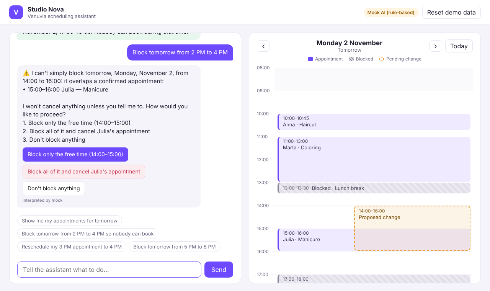

# Studio Nova: Natural-Language Scheduling Assistant

A small web app for Venuvia's assignment. A salon owner chats with an AI assistant to manage their schedule: block time, reschedule or cancel appointments, remove blocks, and view the day. **The assistant always explains what it will do and waits for confirmation before anything changes.**



Demo recording: [`docs/demo.webm`](docs/demo.webm). It covers the schedule view, block, confirm, the 14:00–16:00 conflict case, a reschedule, a reschedule conflict with suggested slots, an invalid date and a clarifying question. Screenshots are in [`docs/screenshots/`](docs/screenshots).

## Quick start

Requires Node.js 20+.

```bash
npm install
npm start            # http://localhost:3000
```

By default it runs with the **rule-based mock interpreter**, so no API key is needed. To use Claude for language understanding instead:

```bash
ANTHROPIC_API_KEY=sk-ant-... npm start
# optional: ANTHROPIC_MODEL=claude-opus-5-5 (default), AI_MODE=mock to force the mock
```

The badge in the top-right corner shows which interpreter is active.

```bash
npm test             # 21 tests: scheduling logic, conflict flow, parser, LLM adapter
```

> **Data is in memory.** The schedule is seeded on startup with the three appointments and the lunch break, all for *tomorrow* in Europe/Warsaw time. Every change is lost when the server restarts. The "Reset demo data" button restores the seed without a restart.

## Things to try

| Message | What happens |
|---|---|
| `Show me my appointments for tomorrow` | Lists the day in chat and jumps the timeline to it |
| `Block tomorrow from 5 PM to 6 PM` → `yes` | Proposal → confirmation → block created |
| `Block tomorrow from 2 PM to 4 PM` | **Conflict with Julia's 15:00 manicure.** Offers: block only 14:00–15:00 / block all and cancel Julia (explicit, red) / do nothing. A plain "yes" is not accepted here. |
| `Reschedule my 3 PM appointment to 4 PM` | Finds Julia's appointment, keeps its 60-minute duration, asks to confirm |
| `Move Anna to 11:30` | Refused: it overlaps Marta. Suggests nearby free slots; replying `13:30` continues the request |
| `Block February 30 2pm-4pm` / `Block yesterday 2-4pm` / `Block tomorrow 4pm to 2pm` | Invalid date / past time / end before start |
| `Block tomorrow afternoon` / `Block 9 to 10am` | Clarifying question ("what exact times?" / "which day?"); the answer is merged with the earlier request |
| `Cancel my appointment` | Several match, so it asks which one |
| `Remove the lunch break block tomorrow` | Proposal to unblock 13:00–13:30 |

## Architecture

```
 Browser (public/)                    Server (src/)
 ┌───────────────┐  POST /api/chat    ┌───────────────────────────────────────────────────────┐
 │ Chat panel    │ ─────────────────▶ │ assistant.js   orchestration + confirmation state     │
 │ Day timeline  │                    │   │  1. text ──▶ interpreter ──▶ intent (structured)  │
 │ (shows pending│ ◀── reply text,    │   │       ├─ interpreter/llm.js   Claude tool call    │
 │  change as a  │     proposal +     │   │       └─ interpreter/mock.js  regex fallback      │
 │  dashed box)  │     option buttons │   │  2. intent ──▶ validate + plan (read-only)        │
 │               │                    │   │  3. pending proposal stored, nothing changed yet  │
 │ [Yes] [Cancel]│  POST /api/confirm │   │  4. on confirm: re-validate, then mutate          │
 └───────────────┘ ─────────────────▶ │   ▼                                                   │
                    GET /api/schedule │ scheduling.js  the ONLY code that mutates data        │
                                      │ store.js       in-memory appointments + blocks        │
                                      └───────────────────────────────────────────────────────┘
```

**The LLM never writes data.** Claude gets the message, recent conversation, current local time and the next two weeks of the schedule (with IDs). It must answer with exactly one tool call: `propose_block_time`, `propose_reschedule`, `propose_cancel_appointment`, `propose_unblock`, `show_schedule` or `ask_clarification`. These tools are not executed against data. They are typed intents. The backend then:

1. **Validates** the intent: real date, valid times, end after start, not in the past, under a year ahead, and the referenced appointment or block exists.
2. **Plans** the change read-only: conflict detection, free segments, and for reschedules opening hours plus suggested free slots.
3. **Stores a pending proposal** for the session and returns a human-readable summary with option buttons. The timeline shows the proposed range as a dashed box.
4. **Executes only on explicit confirmation**, either a button or a typed reply. Confirmation is handled **in code, not by the LLM**: `yes`/`no`/`1`/`2`/"cancel her appointment" are matched deterministically. Any other message drops the pending proposal without executing it.
5. **Re-validates at execution time.** If the schedule changed after the proposal was made (e.g. a client booked online meanwhile), the change is not applied and the assistant re-asks.

Both interpreters produce the same intent shape, so the whole pipeline after step 1 is identical and covered by tests. That includes the Claude path: a test injects a fake Anthropic client to verify that a tool call goes through the same validation.

### Data model

Same as the brief: `Appointment { id, businessId, clientName, serviceName, startAt, endAt, status }` and `AvailabilityBlock { id, businessId, startAt, endAt, reason? }`. Timestamps are stored as ISO 8601 with offset (`2026-11-02T15:00:00+01:00`), never as "tomorrow". All date math uses luxon in the business timezone (`Europe/Warsaw`), so DST transitions are handled.

### Conflict rules

- **Block over an appointment:** never silent. The owner chooses between blocking only the free parts, blocking everything and cancelling the named appointment(s) (shown in red), or doing nothing. A bare "yes" is treated as ambiguous for this proposal.
- **Block over an existing block:** allowed and mentioned. A range already fully blocked is reported as "nothing to change".
- **Reschedule into a busy or after-hours slot:** refused with the reason and up to three nearby free slots of the same length.
- **Blocking outside opening hours:** allowed with a note, since owners may want to block evenings.

## Trade-offs and decisions

- **Plain JavaScript (ESM) + Express + vanilla frontend, no build step.** This fits a 2–3 hour MVP and keeps the review surface small. In a real codebase I'd use TypeScript and a component framework.
- **Two interpreters.** Claude handles real language variety. The mock makes the app runnable and testable without a key, and is the fallback if an API call fails. The mock only covers common phrasings, by design.
- **Claude settings:** `claude-opus-5-5` at `effort: "low"`, since translating text into one tool call is a short task and low effort keeps latency down. The server-side refusal fallback (`fallbacks: "default"`) is enabled. The model can be changed with `ANTHROPIC_MODEL`.
- **Local date + time strings from the LLM** (`"2026-11-02"`, `"14:00"`) rather than ISO timestamps. The server applies the timezone, so the model never does offset math. Impossible dates are passed through on purpose so the backend can explain the problem instead of the model silently "fixing" Feb 30.
- **One pending proposal per session, held in memory.** This is simple and safe: a new request replaces it, and nothing runs without an explicit choice tied to that proposal's ID.
- **Single business, no auth, in-memory store.** All out of scope for the prototype. The store sits behind `ScheduleService`, so swapping in SQLite or Postgres touches one module.
- **No client notifications.** Cancel and reschedule messages mention where the real platform would notify the client.

## What I'd do next

- Persist to a database with transactional writes, and an audit log of who changed what (owner vs assistant).
- Undo for the last change, and multi-day blocks (e.g. "I'm on holiday next week").
- Streaming responses, and multi-step requests in one message ("block 2–4 and move Julia to 5").
- An eval set of real owner phrasings to measure the interpreter's accuracy, plus Polish language support.
- Notify clients on cancel/reschedule via the platform's existing channels.

## Project structure

```
src/
  server.js            Express app + REST API
  assistant.js         conversation flow, proposals, confirmation, execution
  scheduling.js        validation, conflict detection, mutations (ScheduleService)
  store.js             in-memory data + seed
  time.js              timezone helpers (Europe/Warsaw)
  interpreter/
    index.js           picks Claude or mock, falls back on errors
    llm.js             Claude tool definitions + prompt
    mock.js            rule-based parser
public/                single-page UI (chat + day timeline)
test/                  node:test suites
docs/                  demo video + screenshots
```
