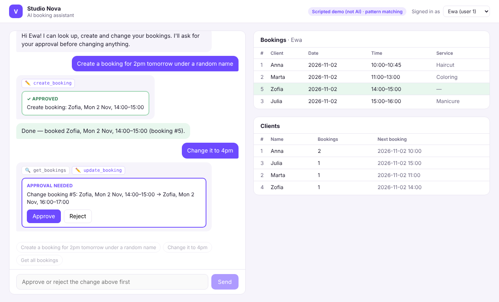

# Studio Nova: AI Booking Assistant

A single-page Next.js app where a salon user chats with an AI assistant that **reads and changes bookings in a local Postgres database**. The AI does its work through function calls (`get_bookings`, `get_clients`, `create_booking`, `update_booking`, `cancel_booking`), and **every change waits for the user to click Approve** before anything is written. A side panel shows live bookings and clients.



The demo script, which is the core flow:
1. *"Create a booking for 2pm tomorrow under a random name"* → approval card → **Approve** → the row appears
2. *"Change it to 4pm"* → the AI calls `get_bookings` to find it, then `update_booking` → **Approve** → the row moves
3. *"Get all bookings"* → the AI lists them
4. *"Cancel Julia's booking"* → lookup, then `cancel_booking` → red **Approve cancellation** → the row stays in the panel, struck through and marked cancelled

Screenshots of each step are in [`docs/screenshots/`](docs/screenshots).

---

## Setup (WSL / Linux / macOS)

You need **Node.js 22.9+** (`node -v`) and **Postgres**.

### 1. Get the code and install
```bash
git clone https://github.com/Azarele/venuvia-scheduler.git
cd venuvia-scheduler
npm install
cp .env.example .env.local
```

### 2. Start Postgres. Pick one option.

**Option A, Docker** (if you have Docker Desktop):
```bash
docker compose up -d
```

**Option B, native install in WSL/Ubuntu:**
```bash
sudo apt update && sudo apt install -y postgresql
sudo service postgresql start
sudo -u postgres psql -c "create user venuvia with password 'venuvia' createdb;" -c "create database venuvia owner venuvia;"
```

Both match the default `DATABASE_URL` in `.env.local`. If you use your own Postgres, edit that line.

### 3. Create the tables and demo data
```bash
npm run db:setup
```
This prints `Database ready: 2 users, 3 clients, 4 bookings.` Re-run it any time to reset the data.

### 4. Add a free AI key
Get a free Gemini key at **https://aistudio.google.com/apikey** and put it in `.env.local`:
```
AI_PROVIDER=gemini
GEMINI_API_KEY=your-key-here
```
OpenRouter works the same way (`AI_PROVIDER=openrouter` + `OPENROUTER_API_KEY`, and pick a free model that supports tool calling in `OPENROUTER_MODEL`). No key at hand? `AI_PROVIDER=scripted` runs an offline pattern-matcher that handles only the three demo sentences. It is **not** an AI, and the badge says so.

### 5. Run
```bash
npm run dev
```
Open **http://localhost:3000**. The badge at the top right shows which AI is active. If the key is missing, a banner explains what to set.

> **"Tomorrow" means tomorrow in salon time** (`Europe/Warsaw` by default). If you test from another timezone late in the evening, the salon may already be on the next day. Set `BUSINESS_TIMEZONE` in `.env.local` (e.g. `Europe/London`) to match your clock. Approval cards always show the relative day, e.g. `Tue 3 Nov (tomorrow)`, so a wrong day is easy to spot before approving.

---

## How it works

```
 Browser (src/app/page.tsx)                 Server (Next.js route handlers)
 ┌────────────────────────┐ POST /api/chat  ┌─────────────────────────────────────────────┐
 │ Chat                   │ ──────────────▶ │ agent.ts                                    │
 │                        │                 │  loop: send conversation + tools to the AI  │
 │                        │                 │   ├ read tool  → run SQL, give result back  │
 │                        │ ◀── reply +     │   └ write tool → run the checks, save as    │
 │ [Approve] [Reject]     │   pending card  │      PENDING, stop. Nothing written yet.    │
 │                        │ POST /api/approve                                             │
 │                        │ ──────────────▶ │  on Approve: re-check, run SQL, tell the AI │
 ├────────────────────────┤                 ├─────────────────────────────────────────────┤
 │ Bookings │ Clients     │ GET /api/bookings│ bookings.ts  plain SQL + simple checks     │
 │ (live from Postgres)   │ GET /api/clients │ db.ts        pg connection pool            │
 └────────────────────────┘                 └──────────────────────┬──────────────────────┘
                                                                   ▼
                                                     Postgres: users, clients, bookings
```

- **The AI never touches the database.** It can only ask for a tool call. Our code decides what runs.
- **Reads run straight away** (`get_bookings`, `get_clients`), and the result goes back to the AI so it can continue. That's how *"change it to 4pm"* works: it looks the booking up, then proposes the update.
- **Writes pause for approval.** The server checks the request, stores it as a pending action (server-side, so the browser can only approve or reject by id and can't alter what runs) and shows a summary card that our code generates, not the AI. On **Approve** the checks run again in case anything changed meanwhile, then the SQL runs inside a transaction. On **Reject** nothing is written. Either way, the outcome goes back into the conversation so the AI knows what happened.
- **Simple checks:** valid time format, end after start, not in the past, max 12 hours, the booking belongs to this user, no overlap with the user's other confirmed bookings, cancelled bookings can't be changed or cancelled twice, and past bookings can't be cancelled. Failures are returned to the AI as errors, and it explains them to the user.
- **Dates:** the AI and UI use local salon time (`"2026-11-02 14:00"`, Europe/Warsaw). Postgres stores real `timestamptz` values, and conversion happens in one place (`src/lib/time.ts`).

### Database schema: why a separate `clients` table

```sql
users    (id, name)                                      -- who owns bookings (owner / staff)
clients  (id, name unique case-insensitive, created_at)  -- the salon's customers
bookings (id, user_id → users, client_id → clients, service, start_at, end_at,
          status 'confirmed' | 'cancelled', cancelled_at, created_at, updated_at)
```

Clients get their own table instead of a name column on each booking. One client books many times. With a copied name, a typo ("Ana" vs "Anna") splits one person into two, and a later phone or email column would have nowhere to live. All bookings live in **one** table that references both the user and the client, so nothing is stored twice. `create_booking` finds the client by name (case-insensitive) or creates them in the same transaction.

Cancelling sets `status = 'cancelled'` instead of deleting the row. The history stays (who cancelled what, and when), while cancelled bookings no longer block the slot or count in the Clients panel. See [`db/schema.sql`](db/schema.sql).

### Switching AI provider (Claude in production)

All providers sit behind one interface in `src/lib/ai/providers.ts`. Gemini and OpenRouter share an OpenAI-compatible adapter, and Claude has its own (the Anthropic SDK). Switching is configuration only:
```
AI_PROVIDER=anthropic
ANTHROPIC_API_KEY=...
```
The tool definitions, agent loop, checks and UI stay the same.

---

## Tests

```bash
npm test
```
10 end-to-end tests run the real agent loop against the real Postgres database, with a fake AI that returns scripted tool calls. They cover: create → approve, "change it to 4pm" (lookup then update), reject, get all bookings, the overlap and past-time checks, another user's booking, re-checking at approval time, relative-day labels, and cancelling (approval, history kept, slot freed, plus its checks). They reset the database, so they need `DATABASE_URL`.

## Project structure

```
db/schema.sql, db/seed.sql     tables + demo data (npm run db:setup)
docker-compose.yml             optional local Postgres
src/app/page.tsx               the single page: chat + approval cards + side panels
src/app/api/*/route.ts         chat, approve, bookings, clients, info
src/lib/ai/agent.ts            agent loop + pending approvals
src/lib/ai/tools.ts            tool definitions (what the AI may call)
src/lib/ai/providers.ts        Gemini / OpenRouter / Claude adapters
src/lib/bookings.ts            SQL queries + simple checks
src/lib/time.ts                timezone handling
test/agent.test.ts             end-to-end tests
```

## Trade-offs (it's a prototype)

- **Plain SQL with `pg`, no ORM.** Short and transparent, close to working with Supabase directly.
- **No auth:** the "Signed in as" picker switches between the seeded users.
- **Conversation kept in the browser**, sent with each request, so a page refresh starts a new chat. Pending approvals are in server memory: fine for one dev server, but production would store them in the database.
- **Overlap check is in application code.** In production a Postgres exclusion constraint would also guard against two simultaneous writes.
- **One change per approval.** If the AI proposes two writes at once, it's asked to propose the second after the first is resolved.

The earlier Express version, built to the original brief with availability blocks and conflict options, is kept on the [`v1-express`](https://github.com/Azarele/venuvia-scheduler/tree/v1-express) branch.
