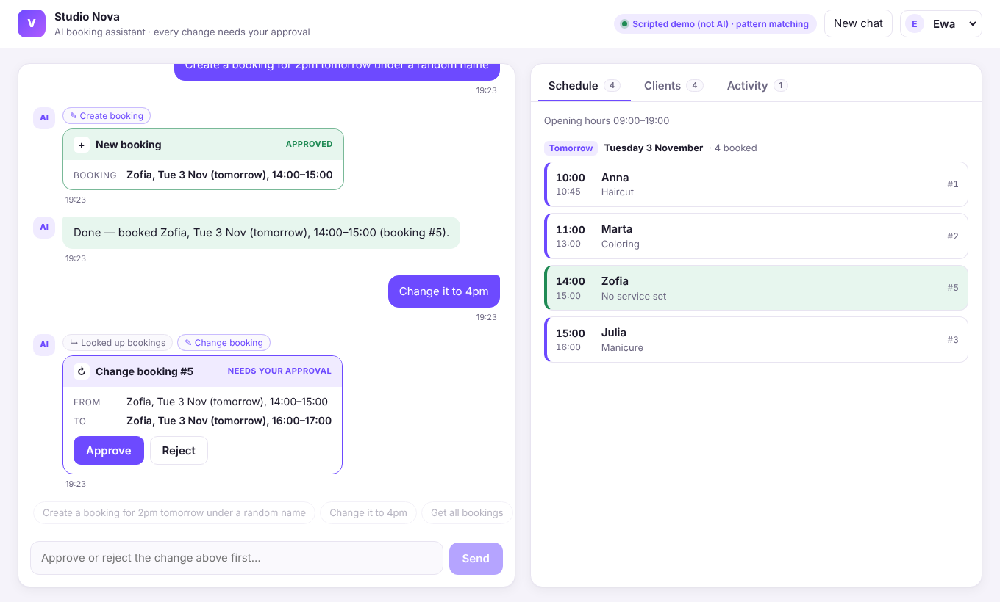

# Studio Nova: AI Booking Assistant

A single-page Next.js app where a salon user chats with an AI assistant that **reads and changes bookings in a local Postgres database**. The AI works only through function calls, and **every change waits for the user to click Approve**. Each approved change is written to an **audit log** together with the state before it, so any change can be **undone**.



| What it does | How |
|---|---|
| Book, move, cancel, look up | AI tools: `get_bookings`, `get_clients`, `find_free_slots`, `create_booking`, `update_booking`, `cancel_booking`, `undo_last_change` |
| Never changes data on its own | Write tools only create a *pending action*; our code runs it after **Approve**, re-checking first |
| Suggests alternatives | When a time is taken, the error includes the nearest free times, and the AI offers them |
| Audit log | `booking_events`: every approved change, who approved it, before and after, in the same transaction |
| Undo | Reverses the last change (repeat to step back). From the chat ("undo that") or the **Undo last change** button; still needs approval |
| No double bookings, guaranteed | A Postgres **exclusion constraint** rejects overlapping confirmed bookings, even if two requests race |
| Survives refreshes and restarts | Chat history and pending approvals are stored in Postgres; each user's chat is locked per request, so two tabs can't overwrite each other |
| Opening hours | Bookings must fit 09:00–19:00 (configurable); outside that, the AI gets the nearest free times |
| Speaks Polish | The AI replies in the user's language; approval cards and confirmations switch to Polish too |
| Feels responsive | Live status while it works ("Looking up your bookings…"); a **Retry** button if the AI times out |
| Shows what it costs | Every reply shows AI calls and tokens (and $ for priced models); the server logs it per message |
| Measured, not guessed | `npm run eval` scores the AI on 29 realistic requests (incl. multi-step and Polish), with `--runs N` for consistency and average tokens/cost per message |

Screenshots of the full flow (create → change → cancel → undo → activity log) are in [`docs/screenshots/`](docs/screenshots).

---

## Setup (WSL / Linux / macOS)

You need **Node.js 22.9+** (`node -v`) and **Postgres** (16 recommended).

```bash
git clone https://github.com/Azarele/venuvia-scheduler.git
cd venuvia-scheduler
npm install
cp .env.example .env.local
```

**Postgres.** Pick one:
- Docker: `docker compose up -d`
- Native (WSL/Ubuntu):
  ```bash
  sudo apt install -y postgresql && sudo service postgresql start
  sudo -u postgres psql -c "create user venuvia with password 'venuvia' createdb;" -c "create database venuvia owner venuvia;"
  ```
  Run `pg_lsclusters`. If the port isn't 5432, change it in `DATABASE_URL` in `.env.local`.

**Tables and demo data.** Re-run this any time to reset:
```bash
npm run db:setup
```

**AI key.** Get a free Gemini key at https://aistudio.google.com/apikey and put it in `.env.local`:
```
AI_PROVIDER=gemini
GEMINI_API_KEY=your-key
```
OpenRouter works the same way (`AI_PROVIDER=openrouter`, `OPENROUTER_API_KEY`, `OPENROUTER_MODEL`). For production use Claude (`AI_PROVIDER=anthropic`, `ANTHROPIC_API_KEY`). `AI_PROVIDER=scripted` is an offline pattern-matcher for the demo sentences only. It is **not** an AI, and the badge says so.

**Run:**
```bash
npm run dev     # http://localhost:3000
```

> **Timezone:** "tomorrow" means tomorrow in **salon time** (`BUSINESS_TIMEZONE`, default `Europe/Warsaw`). Testing from elsewhere late in the evening? Set it to your own zone, e.g. `BUSINESS_TIMEZONE=Europe/London`. Opening hours default to 09:00–19:00 (`BUSINESS_OPEN` / `BUSINESS_CLOSE`).

---

## How it works

```
 Browser                                    Server (Next.js route handlers)
 ┌──────────────────────┐ POST /api/chat    ┌──────────────────────────────────────────────┐
 │ Chat                 │ ────────────────▶ │ agent.ts — loads the chat from Postgres      │
 │                      │                   │  loop: conversation + tools → AI             │
 │                      │                   │   ├ read tool  → SQL, result back to the AI  │
 │                      │ ◀── approval card │   └ write tool → checks, save PENDING, stop  │
 │ [Approve] [Reject]   │ POST /api/approve │                                              │
 │                      │ ────────────────▶ │  Approve: claim pending (once only) → re-check│
 │                      │                   │   → change + audit row in ONE transaction    │
 ├──────────────────────┤                   ├──────────────────────────────────────────────┤
 │ Schedule │ Clients   │ GET /api/bookings │ bookings.ts   SQL + simple checks + undo     │
 │ Activity + Undo      │ GET /api/events   │ conversation.ts  chat + pending approvals    │
 └──────────────────────┘ POST /api/undo    └───────────────────────┬──────────────────────┘
                                                                    ▼
                           Postgres: users · clients · bookings · booking_events
                                     · pending_actions · conversations
```

1. **The AI never touches the database.** It can only request a tool call; our code decides what runs.
2. **Reads run straight away**, and the result goes back to the AI. That's how *"change it to 4pm"* works: it looks the booking up, then proposes the update.
3. **Writes pause.** The request is checked and stored in `pending_actions`, and the user sees an approval card (generated by our code, not the AI) showing **From → To**. The browser can only answer approve/reject by id; it can't alter what will run.
4. **On Approve,** the pending row is claimed atomically, so a double-click can't run it twice. The checks run again, then the booking change **and** the audit row are written in one transaction. On Reject, nothing is written. Either way, the outcome goes back into the conversation so the AI knows what happened.
5. **Typing something new** while a change is waiting rejects the waiting change, so the AI's transcript always stays valid.

**Simple checks:** valid time, end after start, not in the past, at most 12 hours, within opening hours, the booking belongs to this user, no overlap with the user's confirmed bookings (with the nearest free times suggested), no changing or re-cancelling a cancelled booking, and no cancelling a booking that already happened.

### Database

```sql
users            (id, name)
clients          (id, name — unique case-insensitive)
bookings         (id, user_id → users, client_id → clients, service, start_at, end_at,
                  status 'confirmed'|'cancelled', cancelled_at, created_at, updated_at)
                  + EXCLUDE (user_id =, tstzrange(start_at, end_at) &&) WHERE status = 'confirmed'
booking_events   (id, booking_id, action 'created'|'updated'|'cancelled'|'undone',
                  before jsonb, after jsonb, approved_by → users, source 'ai'|'undo-button',
                  undoes_event_id, created_at)
pending_actions  (id uuid, user_id, tool, args, tool_call_id, summary, status, created_at, resolved_at)
conversations    (user_id, history jsonb, bubbles jsonb, updated_at)
```

- **Separate `clients` table:** one client books many times. A name copied onto every booking drifts ("Ana" vs "Anna") and has nowhere to keep a phone or email later. All bookings live in **one** table that references both user and client, so nothing is stored twice.
- **Cancel = `status`, not delete:** history stays, and the slot is freed (the overlap constraint only counts confirmed bookings).
- **Overlap protection in two layers:** the app checks first to give a friendly message with free-time suggestions, and the exclusion constraint (`btree_gist`) is the guarantee when two requests race.
- **Audit log in the same transaction as the change:** a change can't happen without its log row, and vice versa.
- **Undo** finds the user's latest change that hasn't been undone, checks the booking still looks exactly as that change left it (otherwise it refuses), and restores the `before` state. A unique index makes each change undoable only once.

### AI providers (Claude in production)

`src/lib/ai/providers.ts` has one interface with adapters for Gemini and OpenRouter (OpenAI-compatible) and Claude (Anthropic SDK). Switching provider is configuration only (`AI_PROVIDER` + key); the tools, checks, approval flow and UI don't change. Only the last ~40 messages are sent to the AI, which keeps each call small and cheap. Each request has a timeout (`AI_TIMEOUT_MS`, default 60s) and one retry on 503/429.

**Usage and cost:** every AI response reports its tokens; they're summed per message, shown under each reply ("2 AI calls · 3.1k tokens · $0.0004") and logged on the server. Claude list prices are built in (`src/lib/ai/pricing.ts`); for other models set `AI_PRICE_INPUT` / `AI_PRICE_OUTPUT` (USD per million tokens). Gemini's free tier shows tokens only.

---

## Tests and eval

```bash
npm test                     # 23 end-to-end tests (agent + SQL + AI adapter)
npm run test:ui              # browser test of the whole UI (one-time setup: npx playwright install chromium)
npm run eval                 # scores the real AI on 29 realistic requests
npm run eval -- --runs 3     # each case 3 times: shows which cases are consistent and which are flaky
```

**Tests** run the real agent loop and real SQL against a separate **`venuvia_test`** database (created automatically; your data is never touched), with a fake AI that returns scripted tool calls. They cover the approval flow, audit rows, chat persistence, double-approve, moving on while a change waits, overlap suggestions, the database constraint, re-checks at approval, other users' bookings, cancel, multi-step undo, the Undo button, undo refusing when a booking changed in between, opening hours, two simultaneous requests (the per-user lock), Retry after an AI error, token usage and cost, live progress, Polish approval cards, and the AI adapter's timeout and retry (against a local fake server).

**The browser test** (`npm run test:ui`) starts its own dev server on a separate **`venuvia_uitest`** database with the scripted stand-in (no key needed, deterministic), and clicks through create → approve → change → cancel → Undo button → Retry after a simulated AI timeout → reload (the chat is still there) → phone width (no sideways scrolling). It uses its own build folder, so it can run while `npm run dev` is running.

**The eval** sends realistic phrasings to whichever AI is configured, such as *"Push Anna's haircut back by 30 minutes"*, *"Cancel tomorrow's 3pm"*, *"Book a client tomorrow at 2"* (it should ask who) and *"Book Ola at 3:30pm"* (a clash, so it should offer free times). It checks the tool and arguments the AI picks. Six cases are multi-step: earlier messages are sent first and their changes approved or rejected, then a follow-up like *"Change it to 4pm"*, *"Actually, cancel that one"* or *"Undo that"* must hit the right booking. Five cases are in Polish (*"Przełóż Julię na 17:00"*, *"Odwołaj jutrzejszą wizytę o 15"*, …), and one checks opening hours (*"Book Ola tomorrow at 8pm"*). It runs on a separate **`venuvia_eval`** database, reset to the demo data before every case, and ends with the average AI calls, tokens and cost per message. The output looks like this (illustrative, not a real result):

```
Eval: Gemini · gemini-flash-latest · 29 cases
✓  1. Create a booking for 2pm tomorrow under a random name  (2.1s)
✗  7. Push Anna's haircut back by 30 minutes  (3.4s)
      expected: update_booking #1 start 2026-11-03 10:30
      got:      update_booking {"booking_id":1,"start":"2026-11-03 10:00"}
...
N/29 passed · avg X.Xs per case
Per message (avg of 35): 2.1 AI calls · 3,900 input + 120 output tokens · cost n/a
```

Run it with each model you're considering (`AI_PROVIDER` / `*_MODEL`) to pick the cheapest one that passes. `npm run eval -- julia` runs only matching cases, and `EVAL_DELAY_MS` spaces requests out for free-tier rate limits (default 4s). Each AI step is printed as it happens. A request that gets no answer within `AI_TIMEOUT_MS` (default 60s) fails with a clear message instead of hanging, and an overloaded (503) or rate-limited (429) response is retried once.

## Project structure

```
db/schema.sql, db/seed.sql        tables, constraint, audit log + demo data (npm run db:setup)
src/app/page.tsx                  the page: state + wiring
src/app/components/Chat.tsx       chat, tool chips, approval cards
src/app/components/SidePanel.tsx  Schedule / Clients / Activity (+ Undo) tabs
src/app/api/*/route.ts            chat, approve, undo, conversation, bookings, clients, events, info
src/lib/ai/agent.ts               agent loop, pending approvals, Undo button
src/lib/ai/tools.ts               tool definitions + previews for approval cards
src/lib/ai/providers.ts           Gemini / OpenRouter / Claude adapters (timeout, retry, token usage)
src/lib/ai/pricing.ts             token usage → cost per message
src/lib/lang.ts                   English / Polish detection for our own messages
src/lib/bookings.ts               SQL, checks, free slots, audit log, undo
src/lib/conversation.ts           chat + pending approvals in Postgres, per-user lock
scripts/eval.ts                   AI eval
test/                             end-to-end tests (npm test)
test-ui/flow.test.ts              browser test (npm run test:ui)
```

## Left for production

Authentication (the user picker stands in for login), client notifications, multi-staff scheduling rules, and live sync between open tabs (today a second tab waits its turn and sees the other tab's messages on its next reply or a refresh). The earlier Express version built to the original brief is on the [`v1-express`](https://github.com/Azarele/venuvia-scheduler/tree/v1-express) branch.
